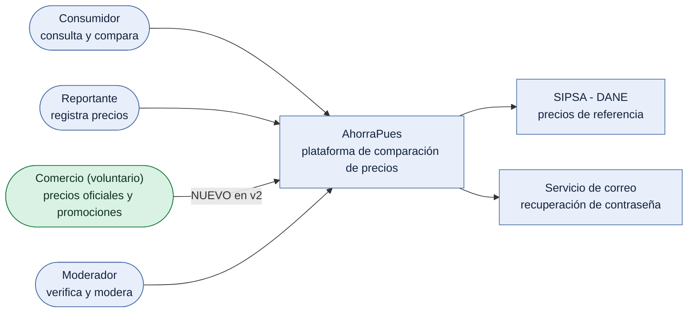
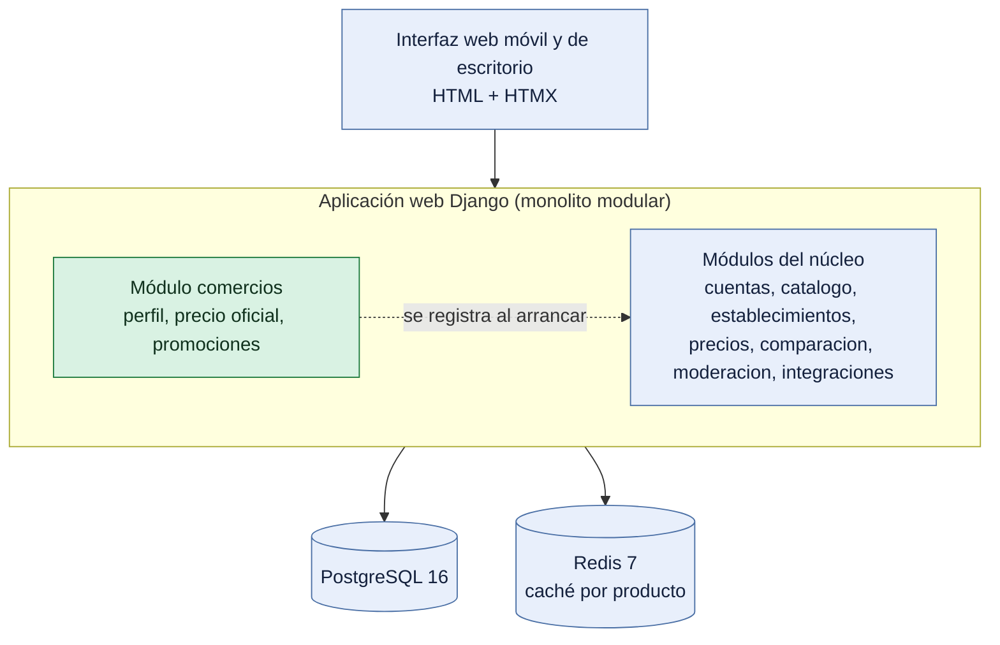
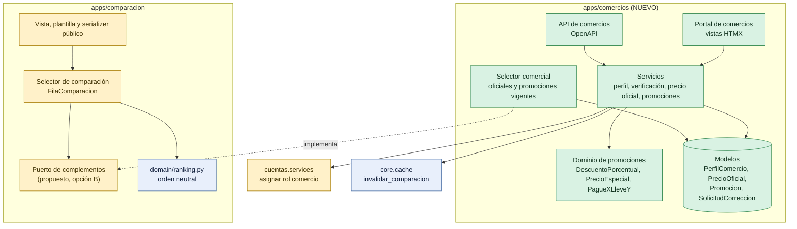

# Arquitectura v2: C4 del módulo comercial

Complementa el [análisis de impacto](../analisis-impacto-modulo-comercial.md). Los diagramas están
en Mermaid para que se vean en GitHub y se revisen como código.

**Leyenda de colores (componentes):** verde = nuevo · amarillo = extensión de un punto previsto ·
azul = sin cambio. Los tres diagramas son *Propuesto*: el módulo se construye en el Corte 3.

> La versión 1 de los diagramas C4 (contexto, contenedores y componentes del núcleo) está descrita en
> el documento de arquitectura v1 del Drive; sus figuras no están versionadas en este repositorio.
> La sección «Qué cambia frente a la v1» resume la diferencia en texto.

## Nivel 1 · Contexto

El único actor nuevo es el **Comercio**; ya estaba previsto como actor desde el Corte 1.

## Nivel 2 · Contenedores

No cambia ningún contenedor: el portal de comercios es parte de la misma aplicación Django.

## Nivel 3 · Componentes del módulo comercial y su integración

Muestra la **opción B** del análisis de impacto (DP-1): `comparacion` no importa `comercios`; el
módulo comercial se registra mediante un puerto. Si el equipo elige la opción A, la flecha punteada
se reemplaza por una importación directa y el contrato `comercios-no-adelantado` se relaja.

`domain/ranking.py` aparece en azul a propósito: es la única función que ordena y **no se modifica**
(EC-06). Los datos comerciales viajan junto al resultado, nunca dentro de la clave de orden.

## Qué cambia frente a la v1

| Elemento | v1 (núcleo, Corte 2) | v2 (con módulo comercial) |
|---|---|---|
| Actores | Consumidor, reportante, moderador | + Comercio (voluntario) |
| Contenedores | App Django, PostgreSQL, Redis, interfaz web | **Iguales** |
| Módulos de la app | 7 módulos del núcleo | + `comercios` (nuevo) |
| Orden de la comparación | `_clave_neutral` | **Igual** (sin cambios) |
| Origen del precio mostrado | Solo reportes (y referencia SIPSA aparte) | Oficial verificado o reportado (ADR-018), con advertencia de discrepancia |
| Promociones | Bandera `es_promocion` sin uso | Etiqueta con condiciones (ADR-014) y, según D-3, arreglo aparte |
| Dependencias entre módulos | El núcleo no conoce `comercios` | Igual con la opción B; con la A, el contrato se relaja |
| Caché | Por producto, TTL 60 s | Igual; `comercios` invalida al publicar |
| Migraciones | — | Solo la inicial de `comercios`; ninguna sobre tablas existentes |
